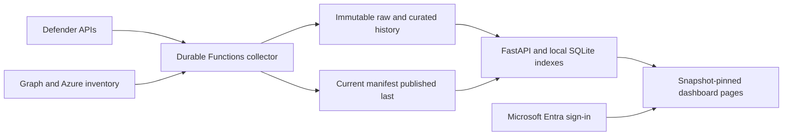

# Vulnerability View

Vulnerability View is a reporting application for Microsoft Defender
Vulnerability Management. It keeps collected evidence and shows what is open,
what changed, which devices are affected, and how remediation compares with
the configured SLA.

Defender still discovers vulnerabilities and reassesses devices. This application
reads that data; it does not patch devices, change Defender findings, or send
workflow status back to Defender. Optional recommendation status is shared
coordination inside this application.

## What it does

- Groups vulnerability findings by CVE, recommendation, device, subscription,
  and operating team.
- Retains raw API responses and normalized snapshots for later inspection.
- Compares collections to distinguish new, remaining, pending, fixed, returned,
  and reopened findings.
- Calculates SLA dates and outcomes from the policy retained with each run.
- Provides current exposure, history, CSV exports, and an Executive Snapshot
  for management reporting.

A **finding instance** is one CVE in a specific software product/version on one
device. The same CVE in the same product/version on 100 devices is 100 instances,
but one distinct CVE. Instances are not attacks or separate patch jobs; one
update can resolve many. Dashboard totals apply to the selected snapshot and
filters, not a sum of repeated scans.

## What it is built with

| Part | Implementation |
|---|---|
| Collection and processing | Python, Azure Functions, Durable Functions |
| Dashboard service | Python, FastAPI, Uvicorn |
| Browser interface | HTML, CSS, and JavaScript; no front-end framework or Node.js build step |
| Reporting indexes | SQLite on the Web App's local disk |
| Retained data | Private Azure Storage / ADLS Gen2; gzip JSON, manifests, policies, and published indexes |
| Hosting | Separate Linux App Service plans for the collector and dashboard |
| Authentication | Managed identities for services; Microsoft Entra and App Service Easy Auth for users |
| Infrastructure | Terraform, with a Python operations CLI and matching Bash/PowerShell menus |
| Tests | pytest and Node.js interaction tests |

Both hosted applications use Python 3.12. Deployment workstation setup uses
Python 3.14; the package supports Python 3.12 and later. Dependency definitions
are in [pyproject.toml](pyproject.toml) and [requirements.txt](requirements.txt).

## How the application works



The collector runs on a schedule or by an explicit operator request. Normal
runs use vulnerability deltas, with full collection for an initial or stale
baseline and the configured weekly reconciliation. Processing checkpoints
allow interrupted work to resume without discarding completed stages.

Each completed collection publishes a new immutable run. The current manifest
changes only after its files are uploaded and verified. A failed collection
does not replace the previous published dataset.

The Web App reads that manifest using its own managed identity. It restores
compatible indexes or builds them from verified datasets, then prepares the
snapshot in the background. The browser receives counts and bounded pages,
not the complete findings dataset. Preparation can follow a restart, first
load, or new snapshot; the UI shows progress while data is unavailable.

Terraform enables a separate persistent viewer cache. Compatible completed
cache artifacts can be restored after a restart. Without that cache, shared
indexes and aggregates are prepared first and additional reports load on
demand. A ready snapshot stays available while its replacement is prepared.
Open browser sessions remain pinned to their selected snapshot until reload.

The detailed [application flow](docs/application-flow.md) covers collection,
publication, startup, caches, queries, and the relevant source files.

## Dashboard flow

| View | Purpose |
|---|---|
| Summary | Current machines/workload instances, unique CVEs, and severity totals; compact SLA status counts by severity |
| Recommendations | One action catalog with exposure filters, Priority ranking, and machine/CVE sorting |
| Vulnerabilities | Unique CVEs by default, with search, paging, and optional technical evidence |
| Endpoint assets | Device inventory and the evidence behind affected-device totals |
| Remediate (SLA) | Machine/CVE SLA outcomes and completion graphs |
| Reporting | Machine/CVE SLA progress, lifecycle changes, and filtered exports |
| Executive Snapshot | Unique machines, CVEs, and recommendations; improved and fully resolved progress for a selected period and scope |
| How to use | Workflow and count definitions inside the application |

Active totals count `Open`, `Reopened`, and `DetectionReturned` findings.
Pending evidence is separate and is not confirmed fixed. A missing finding
does not, by itself, prove remediation. The [calculation rules](LOGIC.md)
explain those distinctions and the [daily workflow](docs/daily-vulnerability-remediation-workflow.md)
covers using the dashboard.

## Deploy or update

The [Azure deployment guide](DEPLOY.md) contains workstation prerequisites,
permissions, environment setup, deployment steps, and verification.
The [greenfield checklist](docs/greenfield-deployment.md) is the shorter path
for an operator who already has those prerequisites.

Normal hosted operations use the matching deployment menus:

```bash
./infra/deployment-menu.sh
```

```powershell
.\infra\deployment-menu.ps1
```

| Change | Deployment needed |
|---|---|
| Dashboard or dashboard-server code | Web App only |
| Collector code | Function only |
| Shared Python code | Each affected application |
| Infrastructure, identity, or hosted settings | Reviewed Terraform plan for the highest deployed cumulative stage |
| Fresh source data | A collection, not a code deployment |

Publishing source does not deploy an application. Deploying code does not
start a collection. In-app approval and automatic application updates are not
implemented; updates still use the deployment tools.

## Normal operations

The [operations guide](docs/operations-and-configuration.md) covers run status,
manual collection, application updates, access, startup logs, and snapshot export.
The [troubleshooting guide](docs/troubleshooting.md) is organized by symptom.

The main operational checks are:

- Collection status and the latest completed manifest, not just a successful
  trigger request.
- Snapshot time and scope before comparing dashboard counts with Defender.
- `dashboardReady` and preparation status, not just an HTTP 200 from
  `/api/health`.
- Local disk and worker capacity during index preparation and snapshot replacement.

## Data protection boundary

- Retained `raw/`, `curated/`, and `runs/` paths are append-only and use
  `overwrite=False`.
- Only `current/manifest.json` in the separate pointer container is replaceable
  within the retained run publication process.
- Application code does not delete retained history or configure automatic
  lifecycle deletion.
- Replacing hosting resources or cleaning local output does not authorize
  deletion of Azure history.
- Function runtime storage is separate from the protected history account.
- Dashboard workflow, branding, and disposable viewer caches have separate
  storage paths and permissions; they are not source findings.

The [data reference](docs/data/README.md) defines storage paths, datasets,
lineage, and retention. Destructive test-environment teardown requires separate
approval naming the exact target; it is not part of a routine update or reset.

## Taking over maintenance

The repository does not contain everything needed to operate an existing
deployment. A handoff also needs:

- Access to the correct repository branch and Azure tenant/subscription.
- The protected environment values in `infra/terraform/main.tfvars.json`.
- The authoritative Terraform state and its backup location. State is local
  by default; a fresh clone is not a replacement for it.
- The Entra application, managed identities, user/group assignments, and the
  administrators responsible for them.
- The approved SLA policy, collection schedule, history storage names, and
  operational monitoring arrangements.

Those details belong in the organization's approved handoff location, not in
this public repository. Environment files, state, secrets, customer snapshots,
and diagnostic exports must stay out of source control.

## Repository map

| Path | Contents |
|---|---|
| [function_app.py](function_app.py) | Function triggers and Durable activity entry points |
| [src/vulnerability_view/](src/vulnerability_view/) | Collection, lifecycle, Storage, query engine, dashboard service, and CLIs |
| [dashboard/](dashboard/) | Browser interface and presentation settings |
| [infra/](infra/) | Terraform, deployment menus, and operator wrappers |
| [config/](config/) | Versioned SLA policy and configuration examples |
| [tests/](tests/) | Tests and opt-in scale benchmarks |
| [tools/](tools/) | Sample transfer, index maintenance, load tests, and cost calculator |
| [docs/README.md](docs/README.md) | Documentation map |

Local setup, tests, release versions, and index maintenance are in the
[development guide](docs/development.md). The [configuration reference](docs/configuration-reference.md)
lists settings; the [command reference](docs/command-reference.md) lists commands.

## Important notices

The supplied SLA thresholds are examples, not an adopted organizational policy.
SLA reporting needs approved targets before it is used for operational or
compliance decisions.

Vulnerability View is an independent project, not a Microsoft product. The
software and documentation are provided as-is without warranty. Suitability,
security, permissions, recovery, compliance, and availability require validation
for the environment.

Every deployed Azure resource can incur charges. The local
[Azure cost calculator](tools/calculator.html) and
[hosting and cost notes](docs/web-app-deployment-recommendations.md) describe
the inputs. Current prices are available in the
[Azure Pricing Calculator](https://azure.microsoft.com/pricing/calculator/).
