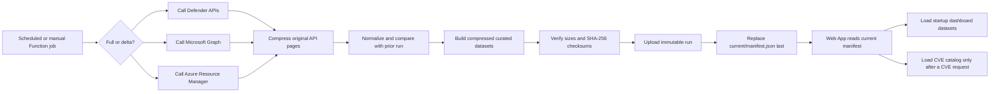

# Application flow: from collection job to dashboard

> **Last modified:** 2026-10-12
> **Purpose:** Explain, in one straight line, what the application calls, what it collects, which files it writes, what the dashboard loads, and why the flow works this way.

## The short version

There are two separate runtime paths:

1. **The collector job** calls Defender, Microsoft Graph, and Azure Resource
   Manager. It keeps the original response pages, builds smaller reporting
   datasets, compresses both forms, and publishes one completed immutable run.
2. **The Web App** reads the completed run. It loads the datasets needed to
   build the dashboard, but it does not load the CVE-detail catalog into the
   browser during startup. CVE descriptions and detailed evidence are requested
   only when a user opens a specific CVE.



## 1. What starts a collection

The normal hosted job is the Azure Function timer. The schedule comes from
`COLLECTION_SCHEDULE`; the supplied default is `0 0 5 * * *`, or 05:00 UTC
each day.

The timer starts the collector with:

```text
vulnerability collection = auto
recommendation enrichment = auto, which currently resolves to targeted
```

A manual full invocation is different. It explicitly requests:

```text
vulnerability collection = full
recommendation enrichment = full
```

Publishing Function code does not start a collection. Publishing the Web App
does not start a collection. A run starts only when the timer fires or an
operator deliberately invokes the Function.

## 2. How the job decides between full and delta

The normal setting is `VULNERABILITY_COLLECTION_MODE=auto`.

| Situation | Mode selected | Reason |
|---|---|---|
| No prior published finding and CVE baseline | Full | There is nothing against which to apply a delta. |
| Prior baseline is more than 14 days old | Full | Defender's vulnerability-change endpoint cannot bridge more than 14 days. |
| First collection on the configured weekly day | Full | Rebuild the vulnerability baseline and remove the risk of accumulated delta drift. |
| Later collection on that same weekly day | Delta | The weekly full has already established that day's baseline. |
| Normal daily collection | Delta | Collect only vulnerability changes instead of repeatedly downloading every machine/CVE relationship. |
| Operator selects manual full | Full | Force a complete vulnerability and recommendation relationship reconciliation. |

The supplied weekly setting is `FULL_COLLECTION_WEEKDAY=6`, which is Sunday in
Python's Monday-zero weekday numbering.

This is the specific weekly guidance implemented in the application:

- The first successful run on Sunday performs a full vulnerability
  reconciliation.
- If another scheduled run occurs on Sunday, it uses delta from the Sunday
  baseline.
- A missing or stale baseline also forces full, regardless of weekday.
- A manual full operation is broader than the automatic Sunday run because it
  also calls every applicable recommendation-to-machine endpoint.

The weekly full is not a second history model. It produces the same output
files as a delta run. The difference is how the current vulnerability evidence
is obtained before those files are built.

## 3. Exactly what the collection job calls

Every API response page is archived before normalization. Raw filenames use
the endpoint name and page number:

```text
<endpoint-name>-page-0001.json.gz
<endpoint-name>-page-0002.json.gz
```

### Microsoft Defender for Endpoint

| Call | When | Telemetry collected | Raw file |
|---|---|---|---|
| `GET /api/machines` | Every run | Defender device inventory, OS/platform, health, exposure, tags, and Azure resource evidence supplied by Defender | `machines-page-####.json.gz` |
| `GET /api/vulnerabilities/machinesVulnerabilities` | Full vulnerability run | Complete device/CVE/product/version finding relationships | `machine_vulnerabilities-page-####.json.gz` |
| `GET /api/machines/SoftwareVulnerabilityChangesByMachine?sinceTime=<prior-snapshot>` | Delta run | New, fixed, and updated device vulnerability relationships since the prior published snapshot | `vulnerability_changes-page-####.json.gz` |
| `GET /api/vulnerabilities` | Full vulnerability run | Defender CVE catalog, including description, severity, CVSS, exploit indicators, dates, and status when supplied | `vulnerabilities-page-####.json.gz` |
| `GET /api/vulnerabilities?$filter=updatedOn ge <prior-snapshot>` | Delta run | CVE catalog rows changed since the prior snapshot | `vulnerabilities-page-####.json.gz` |
| `GET /api/vulnerabilities?$filter=id eq '<CVE>' ...` | Delta run only when needed | Details for a CVE referenced by a changed finding but missing from the reconstructed catalog | `vulnerability_delta_details--#-page-####.json.gz` |
| `GET /api/recommendations` | Every run | Defender recommendation name, product, category, remediation text, exposure impact, score impact, status, and exposed-machine count | `recommendations-page-####.json.gz` |
| `GET /api/recommendations/{id}/machineReferences` | Based on enrichment mode | Machines affected by a recommendation when the relationship cannot be derived locally, or for every applicable recommendation during manual full enrichment | `recommendation_machines--<id>-page-####.json.gz` |
| `GET /api/remediationTasks` | Only when experimental endpoints are enabled | Supporting Defender remediation-task evidence | `remediation_tasks-page-####.json.gz` |

Targeted recommendation enrichment avoids repeating expensive API calls:

- Vulnerability recommendation relationships are derived from the collected
  machine/CVE/product evidence.
- The collector calls `machineReferences` for non-vulnerability
  recommendations that still need an explicit machine relationship.
- Manual full enrichment calls `machineReferences` for every applicable
  recommendation so the relationship set can be completely reconciled.

### Microsoft Graph

| Call | When | Telemetry collected | Raw file |
|---|---|---|---|
| `GET https://graph.microsoft.com/v1.0/security/secureScores?$top=1` | Every run; optional if unavailable | Latest Microsoft Secure Score observation | `secure_scores-page-0001.json.gz` |

### Azure Resource Manager

| Call | When | Telemetry collected | Raw file |
|---|---|---|---|
| `GET .../managementGroups/{id}/descendants` | Every run when a management group is configured | Subscription IDs, names, state, and tenant context beneath the configured management group | `azure_subscriptions-page-####.json.gz` |
| `GET .../subscriptions` | Every run when no management group is configured | Subscriptions visible to the collector identity | `azure_subscriptions-page-####.json.gz` |

Secure Score and Azure subscription inventory are optional supporting sources.
The required Defender calls determine whether the vulnerability run can be
published as complete.

## 4. What happens after the calls finish

The collector does not send the raw API response directly to the dashboard.
It performs the following steps:

1. **Reconstruct the current vulnerability state.**
   - A full run uses the complete machine-vulnerability response.
   - A delta run applies New, Fixed, and Updated changes to the prior published
     finding baseline.
   - Delta runs archive the reconstructed state as
     `derived_machine_vulnerabilities-page-0001.json.gz` and
     `derived_vulnerabilities-page-0001.json.gz`. This makes the delta run
     independently replayable.
2. **Join the sources.** Device records, machine/CVE rows, CVE details,
   recommendations, recommendation-machine relationships, Secure Score, and
   subscription inventory are correlated into one reporting model.
3. **Keep only useful CVE detail.** The curated vulnerability catalog retains
   only CVEs referenced by collected machine findings. The full unfiltered API
   pages remain available in raw history.
4. **Compare with the prior published run.** Stable finding keys identify
   findings that are new, still present, absent pending confirmation, fixed,
   returned during confirmation, or reopened later.
5. **Calculate SLA evidence.** The retained policy and first-observed time are
   used to calculate due dates and within/outside-SLA results.
6. **Build lifecycle and reporting datasets.** Finding events,
   recommendation events, daily summaries, run history, and reconciliation
   totals are calculated from the current and prior evidence.
7. **Compress the curated files.** Every curated dataset is JSON compressed
   with gzip.
8. **Calculate file size and SHA-256.** Those values are written into the run
   manifest and verified again when the Web App downloads a dataset.

## 5. What files are created

Each run has a unique ID such as:

```text
live-20261012T050000Z
```

### Raw source evidence

```text
raw/YYYY/MM/DD/<run-id>/*.json.gz
```

These are the original API response pages. They answer:

> What did Defender, Graph, or Azure actually return during this run?

Raw pages are used for evidence, troubleshooting, and replay. The dashboard
does not read raw pages.

### Curated application datasets

```text
curated/YYYY/MM/DD/<run-id>/*.json.gz
```

| File | What it contains | Loaded when the dashboard opens? |
|---|---|---:|
| `findings.json.gz` | One current device/CVE/product/version finding instance, including lifecycle, priority, ownership, exploit, and SLA fields | Yes, required |
| `finding-events.json.gz` | New, pending, fixed, returned, and reopened finding transitions retained across runs | Yes, optional history |
| `recommendation-events.json.gz` | Recommendation baseline, activation, inactivity, and reopening events | Yes, optional history |
| `run-history.json.gz` | Compact run-to-run metrics for findings, machines, CVEs, recommendations, and SLA outcomes | Yes, optional history |
| `devices.json.gz` | Normalized Defender device inventory, including devices with no current finding row | Yes, required |
| `vulnerabilities.json.gz` | CVE descriptions and detailed CVE evidence for CVEs referenced by collected findings | **No; requested when CVE detail is opened** |
| `recommendations.json.gz` | Normalized Defender recommendations and remediation guidance | Yes, required |
| `recommendation-machines.json.gz` | Recommendation-to-device relationships, with locally derived and API-derived sources | Yes, optional |
| `remediation-activities.json.gz` | Optional Defender remediation-task evidence when the experimental route is enabled | Only when the feature is enabled |
| `daily-summary.json.gz` | Daily new, fixed, reopened, remaining, exploit, SLA, assignment, pending, and median-time-to-fix measures | Yes, required |
| `collection-runs.json.gz` | Per-endpoint run status, row count, duration, mode, freshness, and error text | Yes, required |
| `reconciliation.json.gz` | Monthly previous/new/fixed/reopened/current control totals used to explain lifecycle reconciliation | No; available through evidence/data-browser tooling |
| `secure-scores.json.gz` | Normalized Secure Score observations | Yes, optional |
| `subscriptions.json.gz` | Subscriptions visible in the configured Azure scope, including subscriptions with no current findings | Yes, optional |

### Run control files

```text
runs/YYYY/MM/DD/<run-id>/sla-policies.json
runs/YYYY/MM/DD/<run-id>/manifest.json
```

- `sla-policies.json` is the exact SLA policy used for that run.
- `manifest.json` records the run ID, snapshot time, schema versions, endpoint
  results, file paths, row counts, compressed sizes, and SHA-256 checksums.

### Current-run pointer

The separate current-pointer container contains only:

```text
current/manifest.json
```

It does not contain another copy of every dataset. It points the Web App to one
completed immutable run.

## 6. Why the current manifest is replaced last

The collector uploads in this order:

1. Raw compressed pages
2. Curated compressed datasets
3. Retained SLA policy
4. Immutable run manifest
5. `current/manifest.json`

Everything except the current pointer uses `overwrite=False`.

This order is deliberate. If collection, compression, validation, or upload
fails, the Web App continues to use the previous complete run. Users do not see
half of one run mixed with half of another run.

## 7. What happens when the Web App loads

The Web App and the browser have separate jobs.

### Web App server

The Web App server uses its managed identity to read Storage. On the first data
request, or after its manifest cache expires, it:

1. Downloads `current/manifest.json`.
2. Confirms that the manifest is marked complete.
3. Compares the run ID with the run ID already cached.
4. Clears cached datasets if the current run changed.
5. Locates only the requested curated file in the manifest.
6. Downloads that compressed file.
7. Verifies its compressed size and SHA-256.
8. Decompresses and parses the JSON.
9. Caches the parsed dataset for the active run.

The configured hosted cache is normally 300 seconds. Cache expiration does not
force every dataset to download again. The next request refreshes the manifest;
datasets remain cached when the run ID is unchanged.

### Browser

The browser first loads the static presentation layer: HTML, CSS, JavaScript,
navigation, empty cards, tables, charts, and loading indicators.

It then requests:

- Runtime health and feature flags
- Authentication status
- The retained SLA policy
- Each startup dataset shown as **Yes** in the table above

Those dataset requests run independently. Required datasets determine whether
the dashboard is usable. Optional datasets can fail without hiding otherwise
valid current data. As each dataset arrives, the browser rebuilds its indexes
and rerenders the views that can now be completed.

The browser is not continuously downloading every stored file. It requests the
published datasets needed for the dashboard and the server serves each dataset
from its active-run cache after the first verified download.

## 8. What happens when a user opens a CVE

The initial `findings` data already includes the CVE ID and the operating fields
needed for counts, severity, exploit flags, prioritization, machine impact,
recommendation grouping, lifecycle, and SLA reporting.

The browser does **not** load `vulnerabilities.json.gz` during startup.

When a user opens a specific CVE:

1. The browser requests:

   ```text
   /api/data/cve-details/<CVE-ID>.json
   ```

2. The Web App maps that request to the curated `vulnerabilities` dataset.
3. On the first CVE request for the active run, the server downloads
   `vulnerabilities.json.gz`, verifies it, decompresses it, and caches the
   referenced-CVE catalog.
4. The server selects the requested CVE row and returns only that row to the
   browser.
5. Later CVE requests use the server cache until the run changes or the
   process cache is lost.

That distinction matters:

- The **browser** receives only the requested CVE detail.
- The **server** downloads the compact referenced-CVE catalog on the first CVE
  request, not during dashboard startup.
- The original full Defender vulnerability pages remain in raw history and
  are never sent to the browser.

## 9. One normal week

Using the supplied daily schedule and Sunday reconciliation:

```text
Monday through Saturday
  Read prior published baseline
  Call vulnerability delta endpoint
  Apply changes
  Publish a complete immutable run

Sunday, first run
  Call full machine-vulnerability endpoint
  Call full vulnerability catalog
  Rebuild baseline
  Use targeted recommendation enrichment
  Publish a complete immutable run

Sunday, any later run
  Use delta from the Sunday full baseline

Manual full operation
  Rebuild full vulnerability baseline
  Call every applicable recommendation-machine endpoint
  Publish a complete immutable run
```

The outcome is the same shape every day: one complete run containing raw
evidence, curated reporting files, policy, checksums, and a manifest. The
collection mode changes the source work required to produce that run; it does
not change what the dashboard expects.

## 10. Why the logic is structured this way

| Design choice | Why |
|---|---|
| Daily delta | Avoid repeatedly downloading and processing the largest Defender relationship datasets. |
| Weekly full | Re-establish the complete vulnerability baseline so a sequence of deltas does not become the only source of truth. |
| Full fallback after 14 days | Respect Defender's maximum delta lookback and avoid pretending an incomplete delta is a complete snapshot. |
| Raw plus curated files | Preserve source evidence while giving the dashboard smaller, consistent reporting datasets. |
| Gzip compression | Reduce Storage use and data transfer for large JSON responses and datasets. |
| Immutable run folders | Make every published snapshot explainable and replayable. |
| Current pointer published last | Prevent partial runs from becoming visible. |
| Independent startup requests | Let completed dashboard sections render without waiting for every optional source. |
| Lazy CVE detail | Keep the CVE catalog out of the browser's initial load while preserving detailed descriptions when requested. |
| Server cache by run ID | Avoid downloading and decompressing the same dataset for every browser request. |

## Source-of-truth implementation

- Collector trigger: [`function_app.py`](../function_app.py)
- Full/delta selection and run publication:
  [`dataprep_cli.py`](../src/vulnerability_view/dataprep_cli.py)
- Defender calls and paging:
  [`defender_client.py`](../src/vulnerability_view/defender_client.py)
- Normalization and recommendation relationships:
  [`live_collector.py`](../src/vulnerability_view/live_collector.py)
- Raw/curated compression, manifest, upload, and download:
  [`storage_writer.py`](../src/vulnerability_view/storage_writer.py)
- Lifecycle summaries:
  [`summary_builder.py`](../src/vulnerability_view/summary_builder.py)
- Server cache and CVE-detail routing:
  [`dashboard_server.py`](../src/vulnerability_view/dashboard_server.py)
- Browser startup and lazy CVE request:
  [`app.js`](../dashboard/app.js)
