# Application flow: from collection job to dashboard

> **Last modified:** 2026-11-03
> **Purpose:** Explain, in one straight line, what the application calls, what it collects, which files it writes, what the dashboard loads, and why the flow works this way.

## The short version

There are two separate runtime paths:

1. **The collector job** calls Defender, Microsoft Graph, and Azure Resource
   Manager. It keeps the original response pages, builds smaller reporting
   datasets, compresses both forms, and publishes one completed immutable run.
2. **The Web App** reads the completed run, streams verified curated datasets
   to local disk, builds SQLite indexes, and prepares all nine default views
   before accepting traffic. The browser receives aggregates and bounded table
   pages, not complete findings or lifecycle-event datasets. CVE descriptions
   are indexed on the server when a CVE detail is first requested.

```mermaid
flowchart LR
    A[Scheduled or manual Function job] --> B{Full or delta?}
    B --> C[Call Defender APIs]
    B --> D[Call Microsoft Graph]
    B --> E[Call Azure Resource Manager]
    C --> F[Compress original API pages]
    D --> F
    E --> F
    F --> G[Normalize and compare with prior run]
    G --> H[Build compressed curated datasets]
    H --> I[Verify sizes and SHA-256 checksums]
    I --> J[Upload immutable run]
    J --> K[Replace current/manifest.json last]
    K --> L[Web App reads current manifest]
    L --> M[Stream verified curated files to local disk]
    M --> N[Build indexes and prepare nine default views]
    N --> O[Serve bounded snapshot-pinned browser results]
    O --> P[Index CVE catalog only after a CVE detail request]
```



## 1. What starts a collection

The normal hosted job is the Azure Function timer. The schedule comes from
`COLLECTION_SCHEDULE`; the supplied default is `0 0 5 * * *`, or 05:00 UTC
each day.

The timer starts the collector with:

```text
vulnerability collection = auto
recommendation enrichment = auto, which currently resolves to targeted
```

A manual full invocation is different. It explicitly requests:

```text
vulnerability collection = full
recommendation enrichment = full
```

Publishing Function code does not start a collection. Publishing the Web App
does not start a collection. A run starts only when the timer fires or an
operator deliberately invokes the Function.

## 2. How the job decides between full and delta

The normal setting is `VULNERABILITY_COLLECTION_MODE=auto`.

| Situation | Mode selected | Reason |
|---|---|---|
| No prior published finding and CVE baseline | Full | There is nothing against which to apply a delta. |
| Prior baseline is more than 14 days old | Full | Defender's vulnerability-change endpoint cannot bridge more than 14 days. |
| First collection on the configured weekly day | Full | Rebuild the vulnerability baseline and remove the risk of accumulated delta drift. |
| Later collection on that same weekly day | Delta | The weekly full has already established that day's baseline. |
| Normal daily collection | Delta | Collect only vulnerability changes instead of repeatedly downloading every machine/CVE relationship. |
| Operator selects manual full | Full | Force a complete vulnerability and recommendation relationship reconciliation. |

The supplied weekly setting is `FULL_COLLECTION_WEEKDAY=6`, which is Sunday in
Python's Monday-zero weekday numbering.

This is the specific weekly guidance implemented in the application:

- The first successful run on Sunday performs a full vulnerability
  reconciliation.
- If another scheduled run occurs on Sunday, it uses delta from the Sunday
  baseline.
- A missing or stale baseline also forces full, regardless of weekday.
- A manual full operation is broader than the automatic Sunday run because it
  also calls every applicable recommendation-to-machine endpoint.

The weekly full is not a second history model. It produces the same output
files as a delta run. The difference is how the current vulnerability evidence
is obtained before those files are built.

## 3. Exactly what the collection job calls

Every API response page is archived before normalization. Raw filenames use
the endpoint name and page number:

```text
<endpoint-name>-page-0001.json.gz
<endpoint-name>-page-0002.json.gz
```

### Microsoft Defender for Endpoint

| Call | When | Telemetry collected | Raw file |
|---|---|---|---|
| `GET /api/machines` | Every run | Defender device inventory, OS/platform, health, exposure, tags, and Azure resource evidence supplied by Defender | `machines-page-####.json.gz` |
| `GET /api/vulnerabilities/machinesVulnerabilities?$filter=machineId eq '<id>'&$top=<page-size>` | Full vulnerability run, separately paged for every device returned by machine inventory | Device/CVE/product/version finding relationships; avoids the unfiltered tenant-wide query | `machine_vulnerabilities-page-####.json.gz`, numbered continuously across devices |
| `GET /api/machines/SoftwareVulnerabilityChangesByMachine?sinceTime=<prior-snapshot>` | Delta run | New, fixed, and updated device vulnerability relationships since the prior published snapshot | `vulnerability_changes-page-####.json.gz` |
| `GET /api/vulnerabilities?$filter=id eq '<CVE>' ...` | Full vulnerability run, after findings | Details only for distinct CVEs referenced by included-device findings, in batches of up to 50 IDs with paging; no unfiltered catalog download | `vulnerabilities-page-####.json.gz`, numbered continuously across batches |
| `GET /api/vulnerabilities?$filter=updatedOn ge <prior-snapshot>` | Delta run | CVE catalog rows changed since the prior snapshot | `vulnerabilities-page-####.json.gz` |
| `GET /api/vulnerabilities?$filter=id eq '<CVE>' ...` | Delta run only when needed | Details for a referenced CVE missing from the reconstructed catalog, including unavailable baseline placeholders | `vulnerability_delta_details-page-####.json.gz` |
| `GET /api/recommendations` | Every run | Defender recommendation name, product, category, remediation text, exposure impact, score impact, status, and exposed-machine count | `recommendations-page-####.json.gz` |
| `GET /api/recommendations/{id}/machineReferences` | Based on enrichment mode | Machines affected by a recommendation when the relationship cannot be derived locally, or for every applicable recommendation during manual full enrichment | `recommendation_machines--<id>-page-####.json.gz` |
| `GET /api/remediationTasks` | Only when experimental endpoints are enabled | Supporting Defender remediation-task evidence | `remediation_tasks-page-####.json.gz` |

Full runs collect machine inventory, apply configured scale-set exclusions, and
collect device-scoped findings before fetching the distinct referenced CVE
details and recommendations. Missing requested CVE metadata is retried up to
three times, then reported as non-blocking enrichment warnings. Metadata HTTP
and transport availability failures also preserve findings and permit publication
with `PartialSuccess`. Unexpected catalog IDs and malformed/corrupt evidence
still abort publication. Each CVE is requested in only one batch regardless of the
number of findings that reference it; full batches still follow all pages.
A failed device query aborts publication rather than
silently skipping that device. Device names appear in progress logs, but Defender
machine IDs are used in filters. `CveMetadataStatus=Unavailable` identifies
curated placeholders and affected findings; unknown CVSS, EPSS, and exploit
information is not represented as zero or "no exploit." Delta runs retry these
placeholders on later snapshots. Raw history remains append-only, and the
current pointer advances only after bundle verification.
This serial per-device path still depends on API throughput and the
Function execution limit.

Targeted recommendation enrichment avoids repeating expensive API calls:

- Vulnerability recommendation relationships are derived from the collected
  machine/CVE/product evidence.
- The collector calls `machineReferences` for non-vulnerability
  recommendations that still need an explicit machine relationship.
- Manual full enrichment calls `machineReferences` for every applicable
  recommendation so the relationship set can be completely reconciled.

### Microsoft Graph

| Call | When | Telemetry collected | Raw file |
|---|---|---|---|
| `GET https://graph.microsoft.com/v1.0/security/secureScores?$top=1` | Every run; optional if unavailable | Latest Microsoft Secure Score observation | `secure_scores-page-0001.json.gz` |

### Azure Resource Manager

| Call | When | Telemetry collected | Raw file |
|---|---|---|---|
| `GET .../managementGroups/{id}/descendants` | Every run when a management group is configured | Subscription IDs, names, state, and tenant context beneath the configured management group | `azure_subscriptions-page-####.json.gz` |
| `GET .../subscriptions` | Every run when no management group is configured | Subscriptions visible to the collector identity | `azure_subscriptions-page-####.json.gz` |

Secure Score and Azure subscription inventory are optional supporting sources.
The required Defender calls determine whether the vulnerability run can be
published as complete.

## 4. What happens after the calls finish

The collector does not send the raw API response directly to the dashboard.
It performs the following steps:

1. **Reconstruct the current vulnerability state.**
   - A full run uses the complete machine-vulnerability response.
   - A delta run applies New, Fixed, and Updated changes to the prior published
     finding baseline.
   - Delta runs archive the reconstructed state as
     `derived_machine_vulnerabilities-page-0001.json.gz` and
     `derived_vulnerabilities-page-0001.json.gz`. This makes the delta run
     independently replayable.
2. **Join the sources.** Device records, machine/CVE rows, CVE details,
   recommendations, recommendation-machine relationships, Secure Score, and
   subscription inventory are correlated into one reporting model.
3. **Keep only useful CVE detail.** The curated vulnerability catalog retains
   only CVEs referenced by collected machine findings. The full unfiltered API
   pages remain available in raw history.
4. **Compare with the prior published run.** Stable finding keys identify
   findings that are new, still present, absent pending confirmation, fixed,
   returned during confirmation, or reopened later.
5. **Calculate SLA evidence.** The retained policy and first-observed time are
   used to calculate due dates and within/outside-SLA results.
6. **Build lifecycle and reporting datasets.** Finding events,
   recommendation events, daily summaries, run history, and reconciliation
   totals are calculated from the current and prior evidence.
7. **Compress the curated files.** Every curated dataset is JSON compressed
   with gzip.
8. **Calculate file size and SHA-256.** Those values are written into the run
   manifest and verified again when the Web App downloads a dataset.

Hosted processing commits an immutable continuation after each normalization,
reconciliation, event, summary, history, and bundle stage. Completed stages
survive loss of the worker's local files; an interrupted stage is replayed from
the preceding checkpoint. Processing has no application wall-clock kill timer,
and the Always On Dedicated Function host uses `functionTimeout: "-1"`.
Network request timeouts and retry budgets are independent safeguards.
`[processing]` traces expose stage/substep timings, input/output counts,
compressed bytes, and 60-second heartbeats while long-running work continues.

## 5. What files are created

Each run has a unique ID such as:

```text
live-20261012T050000Z
```

### Raw source evidence

```text
raw/YYYY/MM/DD/<run-id>/*.json.gz
```

These are the original API response pages. They answer:

> What did Defender, Graph, or Azure actually return during this run?

Raw pages are used for evidence, troubleshooting, and replay. The dashboard
does not read raw pages.

### Curated application datasets

```text
curated/YYYY/MM/DD/<run-id>/*.json.gz
```

The table describes server-side use. None of these complete datasets is
downloaded into the browser by normal dashboard startup. Preparing all default
views includes Reporting, so its lifecycle-event indexes are built before the
server becomes ready, not deferred until the first visitor opens Reporting.

| File | What it contains | Server-side use |
|---|---|---:|
| `findings.json.gz` | One current device/CVE/product/version finding instance, including lifecycle, priority, ownership, exploit, and SLA fields | Required for prepared views |
| `finding-events.json.gz` | New, pending, fixed, returned, and reopened finding transitions retained across runs | Optional history indexed for Reporting preparation |
| `recommendation-events.json.gz` | Recommendation baseline, activation, inactivity, and reopening events | Optional history indexed for Reporting preparation |
| `run-history.json.gz` | Compact run-to-run metrics for findings, machines, CVEs, recommendations, and SLA outcomes | Optional input to current metrics and history comparisons |
| `devices.json.gz` | Normalized Defender device inventory, including devices with no current finding row | Indexed for Endpoint assets preparation and machine detail |
| `vulnerabilities.json.gz` | CVE descriptions and detailed CVE evidence for CVEs referenced by collected findings | On first CVE detail request, not default-view preparation |
| `recommendations.json.gz` | Normalized Defender recommendations and remediation guidance | Optional query input; absence is reported in notices |
| `recommendation-machines.json.gz` | Recommendation-to-device relationships, with locally derived and API-derived sources | Optional input to prepared views |
| `remediation-activities.json.gz` | Optional Defender remediation-task evidence when the experimental route is enabled | Available to evidence/compatibility tooling; not a default query dependency |
| `daily-summary.json.gz` | Daily new, fixed, reopened, remaining, exploit, SLA, assignment, pending, and median-time-to-fix measures | Retained output available to evidence/compatibility tooling; server-paged views calculate from indexed evidence |
| `collection-runs.json.gz` | Per-endpoint run status, row count, duration, mode, freshness, and error text | Optional input to freshness and run comparisons |
| `reconciliation.json.gz` | Monthly previous/new/fixed/reopened/current control totals used to explain lifecycle reconciliation | Available through evidence/compatibility tooling |
| `secure-scores.json.gz` | Normalized Secure Score observations | Optional input to prepared views |
| `subscriptions.json.gz` | Subscriptions visible in the configured Azure scope, including subscriptions with no current findings | Optional input to prepared views and subscription filters |

### Run control files

```text
runs/YYYY/MM/DD/<run-id>/sla-policies.json
runs/YYYY/MM/DD/<run-id>/manifest.json
```

- `sla-policies.json` is the exact SLA policy used for that run.
- `manifest.json` records the run ID, snapshot time, schema versions, endpoint
  results, file paths, row counts, compressed sizes, and SHA-256 checksums.

### Current-run pointer

The separate current-pointer container contains only:

```text
current/manifest.json
```

It does not contain another copy of every dataset. It points the Web App to one
completed immutable run.

## 6. Why the current manifest is replaced last

The collector uploads in this order:

1. Raw compressed pages
2. Curated compressed datasets
3. Retained SLA policy
4. Immutable run manifest
5. `current/manifest.json`

Everything except the current pointer uses `overwrite=False`.

This order is deliberate. If collection, compression, validation, or upload
fails, the Web App continues to use the previous complete run. Users do not see
half of one run mixed with half of another run.

## 7. Web App startup, indexing, memory, and caches

### Startup happens on the server, not per visitor

FastAPI's lifespan startup prepares the dashboard before Uvicorn accepts
application traffic. In hosted Azure mode the Web App uses its managed
identity, not the browser user's credentials or a developer's `az login`.

1. Read the current manifest and reject incomplete or unsupported data.
2. Identify the immutable snapshot from its source and manifest, and load the
   SLA policy retained with that snapshot.
3. Create a process-owned temporary cache directory for the snapshot.
4. Download the curated files needed by the default views in chunks. Verify
   compressed byte counts and SHA-256 before making each downloaded file
   available; a failed download is not treated as an empty successful dataset.
5. Stream gzip JSON rows into disk-backed SQLite indexes. Do not construct
   Python lists containing all findings or lifecycle events.
6. Prepare Summary, Vulnerabilities, Recommendations, Prioritize, Endpoint
   assets, Remediate (SLA), Reporting, Executive Snapshot, and How to use.
   Preparation shares the browser's defaults from `dashboard/config.js`.
7. Mark the snapshot ready, start the background refresh watcher, and complete
   application startup.

Initial preparation failure is logged and fails startup; there is no ready
older snapshot in a newly started process. During this startup window,
application health and diagnostics routes cannot be relied on to respond:
use App Service startup/container logs. Terraform allows up to 1,800 seconds
for container startup. This is a startup allowance, not a query timeout or a
performance target. Always On reduces idle unloading, but does not prevent
deployments, platform maintenance, crashes, or other restarts.

### When indexing happens

| Event | Download/index/preparation behavior |
|---|---|
| First server process startup | Build the initial snapshot and prepare default views before serving traffic |
| Another user opens the dashboard | Reuse that process's ready snapshot; no per-user full index build |
| Browser refresh or return to a default view | Reuse server indexes and matching prepared results |
| New filter, search, table page, or detail | Query existing indexes; lazily index an additional dataset if needed |
| New published run | Build separate indexes and default results for the replacement snapshot |
| Process restart, redeployment that restarts the process, or new scale-out instance | Create a new temporary cache and prepare again |

The current cache is a `TemporaryDirectory` owned by the process and removed
on normal shutdown. Leftover files after an abnormal exit are not discovered
or reused by a new process. There is no implemented restart-persistent index
cache. Reuse means reuse across requests within the same running process.

### New snapshots and browser consistency

The watcher checks for replacements at `max(1, DASHBOARD_CACHE_SECONDS)`
seconds. The manifest itself is cached for `DASHBOARD_CACHE_SECONDS`
(Terraform default 300 seconds; application/local default 30 seconds).
These settings govern metadata freshness, not the lifetime of an immutable
dataset index. Expiration does not force the same dataset to download again.

When a different snapshot is detected:

1. Protect the current ready snapshot while preparing the replacement.
2. Download/index the replacement and prepare all default views.
3. Select the replacement for new browser sessions only after preparation
   succeeds. Detection plus preparation takes time; the latest storage
   pointer is not proof that the Web App is already serving that run.
4. Continue serving the previous ready snapshot if replacement preparation
   fails, with an explicit notice and server log.

Browser requests include a `snapshotId`. Queries, details, exports, and the
retained SLA policy stay pinned to that snapshot; an existing session does
not silently switch when the pointer changes. A browser session does not
reserve its snapshot indefinitely: if the local cache evicts it, the server
returns HTTP 409 and the UI requires reload rather than combining two runs.
Recommendation workflow writes additionally reject an outdated snapshot.

### How the Web App controls memory

The index separates typed analytical facts, compressed literal-search text,
and losslessly compressed original JSON evidence. Counts, filtering, grouping,
and standard SLA calculations use indexed facts rather than repeatedly
decompressing full original records. Detail pages, exports, and arbitrary
custom-field grouping read original evidence as needed, preserving existing
semantics rather than substituting approximate calculations. Search computes
matching row IDs once per query and shares them across that query's widgets.

SQLite uses file-backed temporary storage and an approximately 8 MiB page
cache setting per connection. Multiple concurrent connections, Python
objects, response copies, decompression, SQLite work, and the OS filesystem
cache add overhead. None of the following cache limits is a hard cap on
total process or App Service memory.

| Cache or work queue | Scope and implemented bound |
|---|---|
| Prepared default-view results | Per snapshot/query engine: nine entries, 20 MiB serialized budget, 2 MiB maximum per prepared result; separate from ordinary query eviction |
| Other complete view results | Per snapshot/query engine: up to eight entries and 16 MiB serialized budget |
| Shared filter/header results | Per snapshot/query engine: up to eight entries and 8 MiB serialized budget |
| Grouped report records | Per snapshot/query engine: up to eight groups, 16 MiB total accounting budget, 2 MiB per group; oversized groups use paged SQL instead |
| Report total counts | Per snapshot/query engine: up to 32 count entries |
| Asynchronous query jobs | Per process: at most 16 jobs across workspace and report executors, 2 MiB per completed response; completed jobs expire after five minutes when the queue is accessed |
| Browser view/page responses | Per page session: up to 16 entries, estimated 8 MiB total and 2 MiB per entry; not a total browser-heap limit |
| Recommendation workflow reads | Per process: reused for up to five seconds; a successful write invalidates the read cache |

Tracking-enabled browser response entries are reused for at most five seconds.
Snapshot selection, tracking refresh/actions, and explicit retries invalidate
browser response caches. With tracking disabled, unchanged snapshot-pinned
responses can be reused until eviction or invalidation.

### Local disk and worker scaling

Each process retains at most two local snapshots within an 8 GiB total
snapshot-directory budget. The directories include downloaded gzip inputs,
SQLite indexes, and local index auxiliary files. SQLite scratch space may
need additional free disk. Free-space checks reserve at least 128 MiB and
perform additional admission checks during download/indexing.

Only local snapshots without an active acquisition are eligible for eviction.
The served ready snapshot is protected during replacement preparation.
If the replacement cannot fit alongside protected data, preparation fails
explicitly and the old ready snapshot remains selected. Do not assume the
two-snapshot limit guarantees that any two customer snapshots will fit.

The deployment default is one Uvicorn process. Additional processes or
App Service instances each prepare their own indexes, response caches, and
job executors. More workers multiply memory/disk/download work; the 8 GiB
budget is per process, not a shared global allowance. Increasing worker count
is not a free throughput improvement.

All of this is disposable Web App caching, not Azure evidence retention.
Evicting local cache directories never deletes retained raw, curated, run,
policy, or workflow history in Azure Storage. The collector does not need
to rerun merely because a Web App cache was lost.

### Browser loading and background queries

After server startup, the browser loads HTML/CSS/JavaScript and runtime/auth
metadata, then selects the ready snapshot through
`GET /api/dashboard/snapshot`. This returns the snapshot identity, time,
retained policy, and notices, not the finding dataset.

Views, filters, pages, and drill-downs use `POST /api/dashboard/query`.
The server returns aggregates and table pages (normally 100 rows, maximum
200 per table page). Matching prepared results return directly. An uncached
asynchronous request returns HTTP 202 with a stable logical job and a
two-second retry interval; the browser polls short requests until it completes.
Two workspace-query threads and one separate report thread prevent a heavy
Reporting/Executive Snapshot query from occupying every workspace execution
slot. These are threads within each Uvicorn process, not three additional
server processes.

Search input is debounced by 250 ms. Superseded browser requests are aborted
or their responses ignored using request sequence checks. This prevents
stale results from overwriting newer filters; it does not guarantee that an
already-running server computation is cancelled.

CSV exports use `POST /api/dashboard/export` and stream rows from the pinned
server index. The browser does not assemble a complete export in memory.
Normal dashboard navigation does not call the complete-dataset compatibility
routes under `/api/data/`. Those routes still parse/cache complete datasets
and can consume significantly more memory; do not use a full findings
download as a proxy for normal dashboard performance.

### Diagnostics and performance expectations

After startup, authenticated `GET /api/diagnostics` reports:

- `dashboardQueries.mode` (`server-paged`), `maxRetainedSnapshots`, and
  `maxLocalBytes`.
- `retainedSnapshots[]`: snapshot/run IDs, local bytes, and active queries.
- `dashboardQueries.preparation`: status, ready/preparing snapshot IDs,
  preparation duration after success, and replacement error notices.

The `durationSeconds` value measures default-view preparation after snapshot
selection, including dataset downloads and indexing triggered by those views.
It excludes earlier manifest/policy loading and process initialization, so it
is not a complete startup stopwatch. Legacy
`cachedDatasets` diagnostics describe the compatibility data-store cache,
not the disk-backed query indexes. Inspect the snapshot diagnostics and
server logs together. The diagnostics endpoint is not a full memory profiler.

Use the [documented two-million-finding benchmark](../README.md#dashboard-flow)
and [Web App troubleshooting](troubleshooting.md#8-web-app-and-browser).
The benchmark figures in the README identify their measured version and
scope: local engine timings exclude Azure download, HTTP, rendering, and
concurrent users. Cold indexing and all default preparation took about
221 seconds from already-local inputs in the all-detected fixture. This
is not a fixed startup duration for customer hardware/data. Warm view reads
are much cheaper, but uncached filters can still take seconds.

## 8. What happens when a user opens a CVE

Indexed findings already contain the CVE IDs and operating fields needed for
counts, severity, exploit flags, priority, machine impact, and SLA reporting.
Neither the browser's startup nor the default-view preparation downloads the
CVE description catalog into browser memory.

1. The browser submits a snapshot-pinned `detail` query with a CVE selection
   to `POST /api/dashboard/query`.
2. If not indexed yet, the server downloads the snapshot's
   `vulnerabilities.json.gz`, verifies it, and streams it into the local index.
3. The server returns the selected CVE record and bounded related tables.
4. Later CVE requests reuse that snapshot's local index. A new snapshot or
   process has its own catalog/index and may incur preparation again.

The legacy `/api/data/cve-details/<CVE-ID>.json` route remains available, but
is not the normal server-paged drill-down path. Raw Defender pages remain
historical evidence and are not used by normal dashboard queries.

## 9. One normal week

Using the supplied daily schedule and Sunday reconciliation:

```text
Monday through Saturday
  Read prior published baseline
  Call vulnerability delta endpoint
  Apply changes
  Publish a complete immutable run

Sunday, first run
  Call full machine-vulnerability endpoint
  Call full vulnerability catalog
  Rebuild baseline
  Use targeted recommendation enrichment
  Publish a complete immutable run

Sunday, any later run
  Use delta from the Sunday full baseline

Manual full operation
  Rebuild full vulnerability baseline
  Call every applicable recommendation-machine endpoint
  Publish a complete immutable run
```

The outcome is the same shape every day: one complete run containing raw
evidence, curated reporting files, policy, checksums, and a manifest. The
collection mode changes the source work required to produce that run; it does
not change what the dashboard expects.

## 10. Why the logic is structured this way

| Design choice | Why |
|---|---|
| Daily delta | Avoid repeatedly downloading and processing the largest Defender relationship datasets. |
| Weekly full | Re-establish the complete vulnerability baseline so a sequence of deltas does not become the only source of truth. |
| Full fallback after 14 days | Respect Defender's maximum delta lookback and avoid pretending an incomplete delta is a complete snapshot. |
| Raw plus curated files | Preserve source evidence while giving the dashboard smaller, consistent reporting datasets. |
| Gzip compression | Reduce Storage use and data transfer for large JSON responses and datasets. |
| Immutable run folders | Make every published snapshot explainable and replayable. |
| Current pointer published last | Prevent partial runs from becoming visible. |
| Prepare default views before serving | Avoid making the first visitor build every default screen. |
| Disk-backed analytical indexes | Bound in-memory data handling while retaining original detailed evidence. |
| Snapshot-pinned bounded queries | Avoid full browser dataset downloads and mixing runs. |
| Lazy CVE detail | Keep the CVE catalog out of the browser's initial load while preserving detailed descriptions when requested. |
| Per-process snapshot caches | Reuse indexes and bounded results across requests; rebuild after process restart. |

## Source-of-truth implementation

- Collector trigger: [`function_app.py`](../function_app.py)
- Full/delta selection and run publication:
  [`dataprep_cli.py`](../src/vulnerability_view/dataprep_cli.py)
- Defender calls and paging:
  [`defender_client.py`](../src/vulnerability_view/defender_client.py)
- Normalization and recommendation relationships:
  [`live_collector.py`](../src/vulnerability_view/live_collector.py)
- Raw/curated compression, manifest, upload, and download:
  [`storage_writer.py`](../src/vulnerability_view/storage_writer.py)
- Lifecycle summaries:
  [`summary_builder.py`](../src/vulnerability_view/summary_builder.py)
- Server routes, lifecycle, and exports:
  [`dashboard_server.py`](../src/vulnerability_view/dashboard_server.py)
- Snapshot disk retention and streaming:
  [`dashboard_snapshots.py`](../src/vulnerability_view/dashboard_snapshots.py)
- Startup and replacement preparation:
  [`dashboard_preparation.py`](../src/vulnerability_view/dashboard_preparation.py)
- SQLite indexes, analytical queries, and bounded result caches:
  [`dashboard_queries.py`](../src/vulnerability_view/dashboard_queries.py)
- Background query/report jobs:
  [`dashboard_jobs.py`](../src/vulnerability_view/dashboard_jobs.py)
- Browser snapshot selection, bounded requests, and response cache:
  [`app.js`](../dashboard/app.js)
