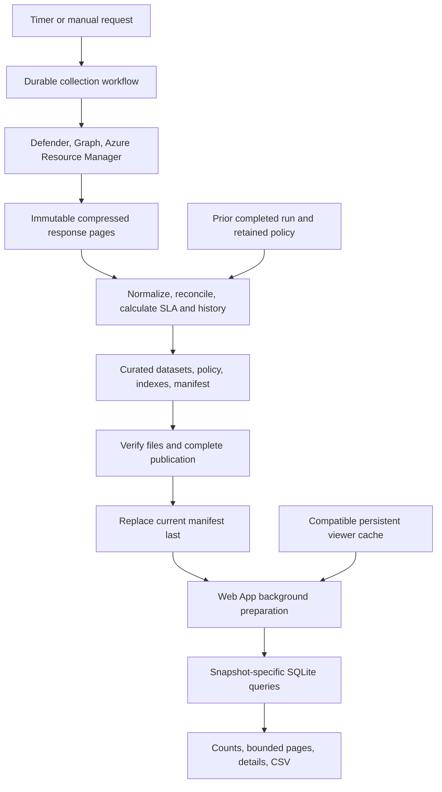

# Application flow

This is the runtime reference: what the collector calls, what it retains, and
how the dashboard reads it. [LOGIC.md](../LOGIC.md) defines calculations;
the [data reference](data/README.md) defines fields and file formats.

## The short version

There are two applications. The collector reads Defender and supporting
inventory, compares observations with the previous run, and publishes a complete
snapshot. The dashboard reads that snapshot and serves reports from SQLite
indexes. The browser does not download the full findings or event history.

## 1. What starts a collection

`function_app.py` hosts the timer, manual starters, status routes, orchestration,
and activity entry points. The timer uses `COLLECTION_SCHEDULE`; the supplied
default is `0 0 5 * * *`, daily at 05:00 UTC.

A starter requests work; a successful request is not proof of publication.
The single Durable instance, `vulnerability-collection`, coordinates active
work. The normal timer uses automatic collection and recommendation enrichment.
A manual full request forces a full vulnerability baseline and full
recommendation relationship refresh when starting a new run.

An active run keeps its original scope. Retrying a failed workflow reuses its
original run identity, frozen settings, policy, baseline, and retained work;
it does not quietly start another snapshot. The
[recovery procedure](../infra/README.md#resumable-collection-deployment-and-recovery)
covers failed executions and earlier deployments.

Publishing Function or Web App code does not invoke collection.

## 2. How the job decides between full and delta

With `VULNERABILITY_COLLECTION_MODE=auto`:

| Condition | Collection |
|---|---|
| No usable prior finding/CVE baseline | Full |
| Baseline older than Defender's 14-day delta lookback | Full |
| First collection requiring the configured weekly reconciliation | Full |
| A weekly full baseline is already available for that day | Delta |
| Normal intervening run | Delta |
| Explicit new manual full request | Full, including complete recommendation enrichment |

`FULL_COLLECTION_WEEKDAY=6` means Sunday, using Python's Monday-zero numbering.
Automatic full runs still use targeted recommendation enrichment; manual full
enrichment refreshes every applicable recommendation-to-machine relationship.

## 3. Exactly what the collection job calls

### Defender

| Endpoint | Use |
|---|---|
| `GET /api/machines` | Inventory, device health, OS, exposure, tags, and Azure ownership evidence |
| `GET /api/vulnerabilities/machinesVulnerabilities` filtered by machine ID | Full findings, paged separately for included devices |
| `GET /api/machines/SoftwareVulnerabilityChangesByMachine?sinceTime=...` | New, fixed, and updated relationships for a delta |
| `GET /api/vulnerabilities` filtered to referenced CVE IDs | Full-run CVE enrichment, in batches of up to 50 IDs |
| `GET /api/vulnerabilities?$filter=updatedOn ge ...` | Changed CVE metadata during delta collection |
| `GET /api/vulnerabilities` filtered to missing referenced IDs | Missing or previously unavailable CVE detail |
| `GET /api/recommendations` | Recommendation names, products, scores, exposure impact, and guidance |
| `GET /api/recommendations/{id}/machineReferences` | Relationships not derived from findings, or all applicable relationships for full enrichment |
| `GET /api/remediationTasks` | Optional experimental remediation-task evidence |

Machine inventory is collected before full findings. Configured scale-set
exclusions are applied before device-scoped calls. A failed required device
query fails the run rather than omitting that device from a successful result.

Missing CVE enrichment is different from missing findings. Only the missing IDs
are retried, up to three targeted attempts. Missing details and metadata
HTTP/transport availability failures can produce `PartialSuccess`, preserving
the finding with `CveMetadataStatus=Unavailable` and unknown scores/exploit
information. Malformed responses, unexpected IDs, and corrupt evidence still
fail explicitly. Later collections retry unavailable detail.

Targeted recommendation enrichment derives vulnerability relationships from
collected findings and calls `machineReferences` for remaining applicable
recommendations. This avoids repeating relationship calls that the evidence
already answers.

### Supporting sources

| Source | Call | Use |
|---|---|---|
| Microsoft Graph | `GET /v1.0/security/secureScores?$top=1` | Latest Secure Score |
| Azure Resource Manager | Management-group `descendants` | Subscriptions under the configured group, including nested groups |
| Azure Resource Manager | Subscriptions list when no group is configured | Subscriptions visible to the identity |

These are optional supporting datasets. Their availability and issues are
recorded separately from required Defender findings.

Responses are paged and archived. Throttling, request timeouts, retry limits,
and continuation behavior are implemented in the collection transport and
workflow; a Durable timer handles long quota cooldowns.

## 4. What happens after the calls finish

1. A full run uses collected device findings. A delta applies changes to the
   prior baseline and archives reconstructed finding/CVE state for replay.
2. Normalization joins devices, findings, CVE metadata, recommendations,
   relationships, score, and subscription context.
3. Stable finding keys support comparison with prior observations.
4. Reconciliation identifies new, pending, fixed, returned, and reopened evidence.
5. The retained SLA policy supplies due dates and remediation timing rules.
6. Event history, run metrics, summaries, and control totals are produced.
7. Curated files and query indexes are built, compressed, and verified.
8. The completed run becomes eligible for publication.

Hosted processing retains verified continuations between normalization,
reconciliation, event, summary, history, and bundle stages. A new worker resumes
from the previous completed stage; an interrupted stage repeats that stage,
not necessarily the whole collection.

The Dedicated Function host uses `functionTimeout: "-1"`. Activity supervisors
enforce a six-hour limit from the original run timestamp, including collection,
waits, retries, processing, verification, and publication. Recovery and continuation
do not reset it. Two-hour warnings report slow runs; expiry stops workers and
reports a timeout. The next trigger starts fresh without deleting expired run
evidence. Network timeouts, retry budgets, platform restarts, and resource limits
still apply.

## 5. What files are created

| Location in the history container | Contents |
|---|---|
| `raw/YYYY/MM/DD/<run-id>/` | Gzip-compressed original and derived response pages |
| `curated/YYYY/MM/DD/<run-id>/` | Compressed normalized datasets |
| `runs/YYYY/MM/DD/<run-id>/sla-policies.json` | Exact policy used by the run |
| `runs/YYYY/MM/DD/<run-id>/index/` | Compressed primary and history SQLite indexes |
| `runs/YYYY/MM/DD/<run-id>/manifest.json` | Completed run inventory, versions, endpoint results, counts, sizes, and hashes |

The separate current-pointer container holds `current/manifest.json`.
It identifies a completed run; it is not another dataset copy.

The main curated files are:

| Dataset | Contents |
|---|---|
| Findings | Current device/CVE/product/version evidence and lifecycle/SLA fields |
| Finding and recommendation events | Retained transitions across collections |
| Devices | Inventory, including devices without current findings |
| Vulnerabilities | Detail for referenced CVEs |
| Recommendations and recommendation machines | Guidance and affected-device relationships |
| Run history and collection runs | Run metrics and endpoint status |
| Daily summary and reconciliation | Reporting and control totals |
| Secure scores and subscriptions | Supporting security and ownership context |
| Remediation activities | Optional experimental task evidence |

The [data reference](data/README.md#published-datasets) lists field definitions.
Raw evidence is used for inspection and replay, not normal dashboard queries.
Local JSON/CSV exports can be overwritten; Azure run paths cannot.

## 6. Why the current manifest is replaced last

Raw evidence, curated datasets, policy, indexes, and the immutable manifest
must be uploaded and verified before the current pointer advances. Retained
writes use `overwrite=False`. Pointer publication checks the expected prior
ETag so a concurrent publisher cannot silently replace a different baseline.

A collection or verification failure leaves the prior published dataset
selected. Partial immutable uploads remain retained; there is no cleanup
deletion of historical evidence.

## 7. Web App startup, indexing, memory, and caches

### Startup and readiness

FastAPI starts the authenticated application shell and prepares data on a
background thread. It does not block all HTTP traffic until indexing finishes.

- `/api/health` is liveness; `dashboardReady` identifies data readiness.
- `/api/dashboard/snapshot` returns HTTP 202 and preparation status until a
  snapshot is ready, then HTTP 200 with its identity and policy.
- `/api/dashboard/status` and `/api/diagnostics` expose progress and failures.
- The UI polls preparation and displays stages, elapsed time, and an expandable
  index checklist. It does not display partial findings or a made-up percentage.

For each snapshot, the server verifies the manifest and retained policy,
restores a compatible primary index or builds it from verified curated files,
and prepares the shared reporting aggregates.

There are two preparation paths:

| Configuration | Before the snapshot is advertised as ready |
|---|---|
| No persistent viewer cache | Prepare shared workspace indexes and aggregates; additional history, search, and report work remains on demand |
| `DASHBOARD_DERIVED_CACHE_CONTAINER` enabled | Restore/build the shared indexes, aggregates, search projection, history index, and all ten default-view results; save completed cache artifacts |

Terraform enables the separate `dvm-viewer-cache` container. Cache reuse checks
snapshot, query format, evidence identity, filters, workload grouping, and policy.
Downloads are size/hash verified, expanded within limits, and checked before
installation. Missing compatible artifacts can be built; corruption and storage
failures are reported, not treated as an empty successful result.

Startup-prepared default results use a separate bounded memory cache and protected
entries in the saved query-products store. Filtered-query churn evicts ordinary
products before defaults, so opening the default reports does not repeat a cold
SLA calculation. Each saved default still requires an exact compatible response
identity; different filters, policies, or response versions cannot reuse it.

Local active indexes are disposable. A restart can restore compatible completed
cache artifacts from Azure instead of rebuilding them. It does not require
another Defender collection. Cache publication never rewrites retained evidence
or the current data pointer.

### Replacement snapshots

The server checks for a new manifest at the configured metadata interval.
The Terraform default is 300 seconds; the application/local default is 30 seconds.
This is not an immutable-index expiry timer.

The previous ready snapshot remains protected while the replacement is prepared.
Preparation failure retains it and reports the failure. New sessions select the
replacement only after readiness. Existing queries, details, exports, and policy
remain tied to the browser's `snapshotId`.

If that local snapshot is later evicted, the API returns HTTP 409 and the UI
requires reload. Recommendation workflow writes also reject stale evidence.

### Resource limits

| Resource | Bound |
|---|---|
| Local snapshot cache | At most two snapshots and 8 GiB per worker |
| Combined expanded published indexes | 7 GiB |
| Shared aggregate model | 512 MiB |
| Shared saved query products | 64 MiB, at most 24 entries including protected defaults |
| Startup-prepared default results in memory | Ten entries, 20 MiB total, 2 MiB per result |
| Browser view/page cache | Up to 16 entries, 8 MiB total, 2 MiB per entry |
| Normal table pages | 100 rows; API maximum 200 |
| Execution capacity | Two interactive workers and one separate heavy-work slot for reports/exports |

These are component limits, not a cap on total process memory or disk.
Downloads, restoration, SQLite temporary work, Python, and the OS need additional
space. Two snapshots are not guaranteed to fit for every customer dataset.
Insufficient space fails preparation while retaining the previous ready snapshot.

The default is one Uvicorn process. More processes or App Service instances
each have their own indexes, caches, and preparation work.

### Browser queries and exports

The browser selects a ready snapshot, then requests the Summary. Other
navigation and details request bounded responses through
`POST /api/dashboard/query`. Completed compatible results are reused.
Equivalent in-flight requests share computation. HTTP 202 means preparation
continues; it is not a partial report.

Search is debounced. Obsolete browser requests are cancelled, and server
queries have cooperative cancellation and execution deadlines. Deadline or
resource exhaustion is an explicit error. Reports and CSV exports share the
heavy-work slot, separate from ordinary navigation.

`POST /api/dashboard/export` streams CSV from the selected snapshot. Normal
navigation does not use the legacy full-dataset `/api/data/` routes.
Those compatibility routes can use substantially more memory and are not a
valid dashboard performance test.

The [operations guide](operations-and-configuration.md) explains startup logs.
The [development guide](development.md#performance-checks) lists reproducible
benchmarks. Local timings are not hosted capacity or response-time guarantees.

## 8. What happens when a user opens a CVE

Finding indexes already have CVE IDs, severity, exploit context, and SLA fields
for normal counts. Detailed descriptions come from the retained vulnerability
catalog.

A CVE detail request indexes that snapshot's catalog when needed, then returns
the selected record and related pages. Later details reuse the local index.
The catalog is not downloaded wholesale into the browser.

## 9. One normal week

With the supplied daily schedule and Sunday reconciliation, intervening runs
use delta, the first required Sunday reconciliation uses full collection, and
later runs that day can use delta from the new baseline. A missing or stale
baseline also forces full.

All modes produce the same completed-run format. The difference is how source
evidence is collected, not what the dashboard expects.

## 10. Why the logic is structured this way

- Deltas reduce repeated API work; full reconciliation re-establishes the baseline.
- Raw evidence allows inspection and replay without recollecting.
- Immutable runs and a final pointer switch keep incomplete data out of reports.
- SQLite and bounded pages keep complete datasets out of browser memory.
- Separate viewer caches reduce repeated startup work without changing evidence.
- Snapshot IDs keep reports, details, exports, and policy consistent.

## Source-of-truth implementation

| Responsibility | Source |
|---|---|
| Triggers and activities | [function_app.py](../function_app.py) |
| Durable orchestration and retained run state | [collection_workflow.py](../src/vulnerability_view/collection_workflow.py) |
| Collection continuation | [collection_worker.py](../src/vulnerability_view/collection_worker.py) |
| Request/retry behavior | [collection_transport.py](../src/vulnerability_view/collection_transport.py), [defender_client.py](../src/vulnerability_view/defender_client.py) |
| Normalization and lifecycle | [live_collector.py](../src/vulnerability_view/live_collector.py), [normalizer.py](../src/vulnerability_view/normalizer.py) |
| Checkpointed processing | [resumable_processing.py](../src/vulnerability_view/resumable_processing.py) |
| Storage and publication | [storage_writer.py](../src/vulnerability_view/storage_writer.py) |
| Dashboard routes and readiness | [dashboard_server.py](../src/vulnerability_view/dashboard_server.py), [dashboard_preparation.py](../src/vulnerability_view/dashboard_preparation.py) |
| Snapshot retention and index restoration | [dashboard_snapshots.py](../src/vulnerability_view/dashboard_snapshots.py) |
| Queries and aggregates | [dashboard_queries.py](../src/vulnerability_view/dashboard_queries.py), [dashboard_read_model.py](../src/vulnerability_view/dashboard_read_model.py) |
| Persistent viewer cache | [dashboard_cache.py](../src/vulnerability_view/dashboard_cache.py), [dashboard_publication.py](../src/vulnerability_view/dashboard_publication.py) |
| Query admission and cancellation | [dashboard_jobs.py](../src/vulnerability_view/dashboard_jobs.py), [dashboard_control.py](../src/vulnerability_view/dashboard_control.py) |
| Browser behavior | [app.js](../dashboard/app.js) |
